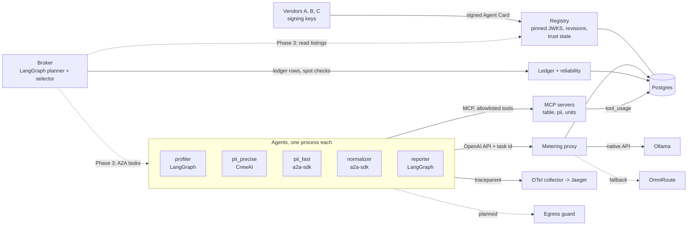

# BOURSE

A2A v1.0 multi-vendor agent exchange: JWS-signed Agent Cards with pinned vendor keys, deterministic
trust and quarantine, cost- and reliability-aware broker over A2A, MCP tools, metered local LLMs,
adversarial benchmark reported as n/N.

[](https://github.com/hamidmatiny/bourse/actions/workflows/ci.yml)

[](LICENSE)


## What it is

BOURSE is an exchange where agents from several vendors are listed, selected and called over A2A
v1.0. A vendor publishes an Agent Card signed with JWS over its RFC 8785 canonical form. The
registry verifies the signature only against a JWKS pinned when the vendor was onboarded, checks
skills against a closed taxonomy of 5 skills, and stores every card revision immutably. Agents call
their own tools over MCP, and every LLM call goes through a metering proxy that records tokens and
wall time per task. A LangGraph broker (Phase 3) will split a dataset-intake job into typed
subtasks and choose an agent per subtask by expected utility: reliability lower bound minus cost
minus latency. The project is built one phase at a time; phases 0–2b are done.

## Why

Agent registries list whatever a card claims. A card signature proves which vendor published the
card; it does not prove that the agent does what the card says, or that it stays honest after
listing. BOURSE adds four things on top of signing:

1. An admission exam: an agent is graded on fixed inputs by deterministic graders before listing.
   The graders exist (Phase 2b, ADR-0023); the exam that gates listing is not built yet.
2. Measured cost and reliability: tokens and wall time come from the metering proxy (built,
   Phase 2a), not from the card; reliability from graded task outcomes comes in Phase 4.
3. Deterministic quarantine: trust state changes are made by code, never by an LLM, and card free
   text is never placed in an LLM prompt (ADR-0008). The trust state machine exists (Phase 1);
   runtime quarantine comes in Phase 5.
4. A benchmark with a frozen test split and a hash manifest, with every metric reported as n/N
   (ADR-0011; Phases 6–7).

## Architecture

Solid lines exist today. Dashed lines are planned, with the phase that adds them.



## Status

| Phase | Scope | Commit | Results (from the operator's acceptance run) |
|---|---|---|---|
| 0 | Skeleton, contracts, runtime limits, submit-tool LLM layer, probe, approval interface, CI | `f641bbe` | 85 unit, 4 live passed |
| 1 | Card crypto (JCS + JWS) and registry | `5791f9c` | 226 unit, 4 db passed; attacks caught 8/8; honest false rejects 0/3 |
| 2a | Skill I/O contracts, MCP servers, MCP adapter, metering proxy | `29f1f31` | 319 unit, 6 db, 6 live passed |
| 2b | Five agents, graders, stack launcher, smoke run | `183ab27` | 367 unit, 6 db, 11 live passed; smoke 18/18 graded passed; 20,532 tokens in / 3,070 out |
| 3 | Broker: planner, selector, card-drift-checked A2A delegation, resumable runs | `e19990a` | 393 unit, 10 db, 12 live passed; e2e runs succeeded 3/3, planner_used llm 3/3, fallbacks 0, subtasks graded passed 15/15; 9,293 tokens in / 1,726 out |
| 4 | Measured ledger, spot-check reliability, measured selection with exploration, OTel, resident memory guard | Phase 4 commit | 446 unit, 19 db, 12 live passed; e2e --repeat 3: runs succeeded 9/9, exploration picks 2, spot-check failures 0/45, subtasks graded passed 45/45; 33,148 tokens in / 5,854 out; shadow_usd 0.009430; resident peak 25,628,315,882 |
| 5 | Trust runtime, adversaries A4–A8, Slack approver | – | planned |
| 6 | Bench harness, Executor pools | – | planned |
| 7 | `--final` run, RESULTS.md | – | planned |

Phase 2b smoke run: 3 fixture datasets (people, measurements, orders), each agent sent every skill
it lists.

| Skill | Agents | Graded passed |
|---|---|---|
| schema.profile | profiler | 3/3 |
| stats.compute | profiler | 3/3 |
| pii.detect | pii_precise, pii_fast | 6/6 |
| units.normalize | normalizer | 3/3 |
| report.compose | reporter | 3/3 |

## Agents

| Agent | Framework | Vendor | Skills | Model (via meter) |
|---|---|---|---|---|
| profiler | LangGraph | vendor-a.local | schema.profile, stats.compute | gemma4:12b |
| pii_precise | CrewAI 1.6.1 | vendor-b.local | pii.detect | qwen3.5:27b-q4_K_M |
| pii_fast | a2a-sdk | vendor-c.local | pii.detect | gemma4:12b |
| normalizer | a2a-sdk | vendor-b.local | units.normalize | gemma4:12b |
| reporter | LangGraph | vendor-a.local | report.compose | qwen3.5:27b-q4_K_M |

Numbers in agent outputs come from MCP tool results; the LLM only makes choices that a tool cannot,
such as which columns hold person names. Structured output always uses a `submit` tool validated
by a Pydantic model (ADR-0019).

## Threat model

| ID | Attack | Status |
|---|---|---|
| A1 | Card claims vendor A, signed with the attacker's key | caught in Phase 1 (`FORGED_SIGNATURE`) |
| A1b | Attacker-signed card with interface URL on vendor A's domain | caught in Phase 1 (`DOMAIN_MISMATCH`) |
| A2 | Signed card edited after signing (description, skill id, interface URL) | caught in Phase 1, 3/3 (`TAMPERED`) |
| A3 | Vendor A's `kid` with `jku` pointing to the attacker's JWKS | caught in Phase 1 (`UNTRUSTED_JKU`) |
| A4–A8 | Runtime adversaries | planned for Phase 5; not yet specified in this repo |
| A9 | Version rollback; same version re-published with changed content | caught in Phase 1, 2/2 (`VERSION_ROLLBACK`, `VERSION_REUSE`) |

Reproduce the Phase 1 table: `uv run bourse attacks phase1`.

## Quickstart

Requirements: macOS or Linux, [uv](https://docs.astral.sh/uv/), Docker, Ollama 0.40.6 on the host
with `gemma4:12b` and `qwen3.5:27b-q4_K_M` pulled, started with
`OLLAMA_MAX_LOADED_MODELS=2 OLLAMA_NUM_PARALLEL=2 OLLAMA_FLASH_ATTENTION=1
OLLAMA_KV_CACHE_TYPE=q8_0 OLLAMA_CONTEXT_LENGTH=4096` (Ollama 0.40.6 ignores per-request
`num_ctx`; 4096 = smallest of 4096/6144/8192 >= 2 x the observed max of 1666 tokens per call,
ADR-0033). Runs sample `/api/ps` every 5 s and abort if the resident total stays above
26,000,000,000 bytes for 30 s. With both models loaded the probe measured
23,993,702,388 resident bytes (limit 26 GB, AGENTS.md rule 9). `gitleaks` is needed only for the
secret scan.

```sh
uv sync
cp .env.example .env
docker compose up -d postgres && uv run alembic upgrade head
uv run bourse keys gen --vendor vendor-a.local
uv run bourse keys gen --vendor vendor-b.local
uv run bourse keys gen --vendor vendor-c.local
uv run bourse probe
uv run bourse stack up          # 10 processes; logs in data/logs/
uv run bourse stack register    # onboards 3 vendors, registers 5 agents
uv run bourse smoke all         # 18 tasks; writes data/smoke/smoke-<utc>.json
uv run bourse stack activate --all   # PENDING -> ACTIVE until the Phase 5 exam (ADR-0028)
uv run bourse run --dataset people --request "audit this dataset for PII, units and summary stats"
uv run bourse e2e all --repeat 3   # broker on 3 fixtures x 3; writes data/e2e/e2e-<utc>.json
uv run bourse scores            # Wilson LB per agent/skill from spot-checked ledger rows
uv run bourse usage maxcall     # tokens per call per model; num_ctx rule (ADR-0033)
uv run bourse ledger export     # data/exports/ledger-<utc>.parquet (pandera-validated)
uv run bourse stack down
```

Tests: `uv run pytest` (unit, no services), `uv run pytest -m db` (Postgres),
`uv run pytest -m live` (Ollama and the running stack).

All services bind to 127.0.0.1:

| Service | Port |
|---|---|
| MCP servers table, pii, units | 55101, 55102, 55103 |
| Metering proxy | 55200 |
| Registry | 55300 |
| Agents profiler, pii_precise, pii_fast, normalizer, reporter | 55401–55405 |
| Postgres | 55432 |
| OTel collector OTLP gRPC / HTTP | 54317 / 54318 |
| Jaeger UI | 56686 |

## Limitations

- Datasets are synthetic fixtures: 3 CSV files written for this project. The smoke run is 18
  tasks, not a benchmark; the frozen benchmark split arrives in Phase 6.
- Everything runs on one machine. Vendors are simulated: the `vendor-*.local` domains do not
  resolve, keys are generated locally, and pinned JWKS are posted by an admin rather than fetched.
- Only local models through Ollama were exercised. Ollama with `OLLAMA_NUM_PARALLEL=2` is not
  bit-reproducible even with temperature 0 and a fixed seed: in one replay through the meter, the
  same normalizer request ended in a valid submit in 2 of 3 runs.
- The adversaries are written by the same author as the defenses.
- No broker, ledger, reliability scores, trust runtime or OTel spans exist yet (phases 3–5).

## Documentation

- [AGENTS.md](AGENTS.md): hard rules and phase plan.
- [docs/adr/](docs/adr/README.md): 33 architecture decision records.

## License

Apache-2.0. See [LICENSE](LICENSE).
