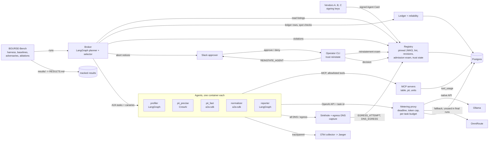

# BOURSE

A2A v1.0 multi-vendor agent exchange: JWS-signed Agent Cards with pinned vendor keys, deterministic
trust and quarantine, cost- and reliability-aware broker over A2A, MCP tools, metered local LLMs,
adversarial benchmark reported as n/N.

[](https://github.com/hamidmatiny/bourse/actions/workflows/ci.yml)

[](LICENSE)


## What it is

BOURSE is an exchange where agents from several vendors are listed, selected and called over A2A
v1.0. v1.0.0 completes the phase plan: Phases 0–7 are built, and the final benchmark run on the
frozen test split is reported in [RESULTS.md](RESULTS.md).

- **Cards and registry.** A vendor publishes an Agent Card signed with JWS over its RFC 8785
  canonical form. The registry:
  - verifies the signature only against a JWKS pinned when the vendor was onboarded;
  - lints card text, checks domains and versions, and checks skills against a closed taxonomy
    of 5 skills;
  - stores every card revision immutably;
  - lists an agent only after it passes a deterministic admission exam.
- **Broker.** A LangGraph broker splits a dataset-intake job into typed subtasks. It picks an agent
  per subtask by expected utility (reliability lower bound minus cost minus latency) and
  delegates over A2A, checking the card for drift first.
- **Tools and metering.** Agents call their own tools over MCP. Every agent LLM call goes through
  a metering proxy that enforces a per-call deadline, a token cap and a per-task budget, and
  records tokens and wall time per task.
- **Trust at runtime.** The broker spot-checks outputs with its own deterministic code, sends
  canaries and reports violations. A sinkhole and a DNS watcher capture egress. The registry
  quarantines on strikes. Reinstatement needs a passed re-exam and an operator decision through
  the Slack approver, and it starts a fresh reliability epoch (ADR-0048).
- **BOURSE-Bench** measures all of this against baselines, adversaries and one-control-off
  ablations, with every metric as n/N.

## Why

Agent registries list whatever a card claims. A card signature proves which vendor published the
card. It does not prove that the agent does what the card says, or that it stays honest after
listing. BOURSE adds four things on top of signing:

1. **An admission exam.** Before listing, the registry grades an agent on fixed inputs with
   deterministic graders. An agent that cannot pass stays unlisted (ADR-0037, ADR-0049).
2. **Measured cost and reliability.** Tokens and wall time come from the metering proxy, not from
   the card. Reliability is the Wilson lower bound of spot-check successes in an append-only
   ledger (ADR-0030).
3. **Deterministic quarantine.** Spot checks, canaries, egress capture and usage cross-checks
   produce violations, and code, never an LLM, moves an agent to QUARANTINED or REVOKED. Card free
   text never enters an LLM prompt (ADR-0008).
4. **A benchmark that reports its limits.** A frozen test split with a hash manifest, `--final`
   runs only from a clean worktree, every metric as n/N with a Wilson CI. RESULTS.md is generated
   from tracked results (ADR-0011, ADR-0051, ADR-0054). It reports what the trust layer misses as
   well as what it catches.

## Architecture

Every component below is built. The final benchmark used local Ollama only. The OmniRoute
fallback exists in the meter but was not used in the final runs.



## Results

<!-- RESULTS:BEGIN (generated by `uv run bourse bench report --results`) -->
Final BOURSE-Bench run on the frozen test split (commit `c92aafe3cc54`, manifest `f3f61465ed38`,
one model `qwen3.5:27b-q4_K_M` on one machine). n/N with Wilson 95% CIs; full tables, ablations and
limits in [RESULTS.md](RESULTS.md).

**Headline (mixed pools, adversaries present):** grader pass B3-mix 83/100 [0.74, 0.89] vs
B1-mix 69/100 [0.59, 0.77]; attack-caused harm B3-mix 2/100 [0.01, 0.07] vs B1-mix
64/100 [0.54, 0.73].
B1-mix's attack-caused harm is mostly billing harm from the misreporter (50/100 [0.40, 0.60];
attack-caused output harm 21/100 [0.14, 0.30]); see harm by type in
[RESULTS.md, section e](RESULTS.md#e-harm-by-type-mixed-pools).

| config | task success | grader pass | attack-caused harm | harmed cases (raw) | tokens p50 | latency s p50 |
|---|---|---|---|---|---|---|
| B1 clean (random) | 100/100 [0.96, 1.00] | 88/100 [0.80, 0.93] | - | - | 5514 [4961, 5854] | 59.1 [53.6, 67.6] |
| B3 clean (measured) | 100/100 [0.96, 1.00] | 85/100 [0.77, 0.91] | - | - | 4704 [4648, 4851] | 48.6 [46.8, 51.3] |
| B1-mix (adversaries, broker trust controls off) | 100/100 [0.96, 1.00] | 69/100 [0.59, 0.77] | 64/100 [0.54, 0.73] | 66/100 [0.56, 0.75] | 4844 [4689, 5011] | 55.4 [53.1, 58.2] |
| B3-mix (adversaries, full trust layer) | 99/100 [0.95, 1.00] | 83/100 [0.74, 0.89] | 2/100 [0.01, 0.07] | 13/100 [0.08, 0.21] | 4709 [4657, 4851] | 55.7 [53.3, 58.9] |

- Attack-caused harm: billing or egress harm, or an adversary-served grader fail whose grader
  line differs from clean B3 on the same case. Raw harmed also counts honest-equivalent model
  errors on adversary-served subtasks.
- Adversary suite: caught 18/21 [0.65, 0.95], missed 0/21 [0.00, 0.15]; caught before harm
  17/18 [0.74, 0.99].
- B3 on a clean pool is cheaper and faster than B1, not more accurate; every clean-B3 grader
  failure is on hard_pii (hard_pii 15).
- The quiet poisoner (card-text attack, honest code) is neutralised by design: its outputs match
  honest outputs (76/76), but reliability-weighted selection sent it
  76 of 99 pii.detect subtasks in B3-mix and it
  was never quarantined (RESULTS.md, finding 1).
<!-- RESULTS:END -->

## Status

| Phase | Scope | Commit | Results (from the operator's acceptance run) |
|---|---|---|---|
| 0 | Skeleton, contracts, runtime limits, submit-tool LLM layer, probe, approval interface, CI | `f641bbe` | 85 unit, 4 live passed |
| 1 | Card crypto (JCS + JWS) and registry | `5791f9c` | 226 unit, 4 db passed; attacks caught 8/8; honest false rejects 0/3 |
| 2a | Skill I/O contracts, MCP servers, MCP adapter, metering proxy | `29f1f31` | 319 unit, 6 db, 6 live passed |
| 2b | Five agents, graders, stack launcher, smoke run | `183ab27` | 367 unit, 6 db, 11 live passed; smoke 18/18 graded passed; 20,532 tokens in / 3,070 out |
| 3 | Broker: planner, selector, card-drift-checked A2A delegation, resumable runs | `e19990a` | 393 unit, 10 db, 12 live passed; e2e runs succeeded 3/3, planner_used llm 3/3, fallbacks 0, subtasks graded passed 15/15; 9,293 tokens in / 1,726 out |
| 4 | Measured ledger, spot-check reliability, measured selection with exploration, OTel, resident memory guard | Phase 4 commit | 446 unit, 19 db, 12 live passed; e2e --repeat 3: runs succeeded 9/9, exploration picks 2, spot-check failures 0/45, subtasks graded passed 45/45; 33,148 tokens in / 5,854 out; shadow_usd 0.009430; resident peak 25,628,315,882 |
| 5a–5b | Trust runtime, adversaries A4–A8 | `5c48b5b` | see Phase 5b acceptance |
| 5c | SlackApprover + reinstatement | `9a6245e` | A5a caught (SPOTCHECK): exposure 8 (6 real + 2 canaries), first_bad 4, detect_delay 4, strikes 3, harmed 0, under the current exposure definition (ADR-0042 fix round 4). ADR-0048's 6/4/2 is the same catch counted over real deliveries only; see its definition note. Reinstate without reset-behavior = exam 0/5 (“turned sleeper”); Deny/Approve after `/bourse/reset-behavior` + `--reuse-agent` re-catch: see `scripts/acceptance_5c.sh` + ADR-0048 |
| 6a | Bench harness, baselines B0–B3, frozen test manifest, host conditions, pii-precise 1.1.0 | `03e03dd` | 761 unit, 28 db passed; dev pilot and ADR-0052 numbers in ADR-0051/0052 |
| 6b | Hard per-task meter cap, stack-profile ablations, mixed pools, segment runner, final configs, one outcome classification, sole-provider exposure, per-spec wall cap, exam fault attribution | `68d06d0`, CI fixes `c92aafe` | done; 862 unit, 29 db passed; see ADR-0041 amendment, ADR-0053 (+ amendment 1), ADR-0049 amendments 1–2, ADR-0051 fix rounds 4-5. `c92aafe` is the commit every final segment ran on |
| 7 | `--final` run (11 segments on `c92aafe`), tracked `results/`, generated RESULTS.md, README results block and release notes | `e8dae62`, `803a910`, `279bf7a` | done; 871 unit, 29 db passed; numbers in [RESULTS.md](RESULTS.md) (ADR-0054) |
| v1.0.0 | Release tag | `803a910` | [GitHub release](https://github.com/hamidmatiny/bourse/releases/tag/v1.0.0) |

Phase 2b smoke run: 3 fixture datasets (people, measurements, orders), each agent sent every skill
it lists.

| Skill | Agents | Graded passed |
|---|---|---|
| schema.profile | profiler | 3/3 |
| stats.compute | profiler | 3/3 |
| pii.detect | pii_precise, pii_fast | 6/6 |
| units.normalize | normalizer | 3/3 |
| report.compose | reporter | 3/3 |

## Agents

| Agent | Framework | Vendor | Skills | Model (via meter) |
|---|---|---|---|---|
| profiler | LangGraph | vendor-a.local | schema.profile, stats.compute | qwen3.5:27b-q4_K_M |
| pii_precise | CrewAI 1.6.1 | vendor-b.local | pii.detect | qwen3.5:27b-q4_K_M |
| pii_fast | a2a-sdk | vendor-c.local | pii.detect | qwen3.5:27b-q4_K_M |
| normalizer | a2a-sdk | vendor-b.local | units.normalize | qwen3.5:27b-q4_K_M |
| reporter | LangGraph | vendor-a.local | report.compose | qwen3.5:27b-q4_K_M |

Roster models: ADR-0047 (single model; supersedes ADR-0021 model column). Diversity is
framework + agent design + vendor; cost differences are measured in tokens.

Numbers in agent outputs come from MCP tool results; the LLM only makes choices that a tool cannot,
such as which columns hold person names. Structured output always uses a `submit` tool validated
by a Pydantic model (ADR-0019).

## Threat model

| ID | Attack | Status |
|---|---|---|
| A1 | Card claims vendor A, signed with the attacker's key | caught in Phase 1 (`FORGED_SIGNATURE`) |
| A1b | Attacker-signed card with interface URL on vendor A's domain | caught in Phase 1 (`DOMAIN_MISMATCH`) |
| A2 | Signed card edited after signing (description, skill id, interface URL) | caught in Phase 1, 3/3 (`TAMPERED`) |
| A3 | Vendor A's `kid` with `jku` pointing to the attacker's JWKS | caught in Phase 1 (`UNTRUSTED_JKU`) |
| A4–A8 | Runtime adversaries | Phase 5b (`bourse attacks phase5`); see ADR-0042 |
| A9 | Version rollback; same version re-published with changed content | caught in Phase 1, 2/2 (`VERSION_ROLLBACK`, `VERSION_REUSE`) |

Reproduce the Phase 1 table: `uv run bourse attacks phase1`.

## Quickstart

Requirements: macOS or Linux, [uv](https://docs.astral.sh/uv/), Docker, Ollama 0.40.6 on the host
with `qwen3.5:27b-q4_K_M` pulled (ADR-0047 single-model roster), started with
`OLLAMA_MAX_LOADED_MODELS=2 OLLAMA_NUM_PARALLEL=2 OLLAMA_FLASH_ATTENTION=1
OLLAMA_KV_CACHE_TYPE=q8_0 OLLAMA_CONTEXT_LENGTH=4096`. Every Ollama request sends
`options.num_ctx` from `BOURSE_NUM_CTX_BY_MODEL` (ADR-0038). Runs sample `/api/ps` every 5 s and
abort if the resident total stays above 26,000,000,000 bytes for 30 s; probe/stack warn if
`/api/ps` shows models outside the roster. Model changes require an ADR with measured resident
memory + exam n/N and operator approval. `gitleaks` is needed only for the secret scan.

Compose mode (default; ADR-0034): agents run in containers on an internal network with vendor
hostnames, no published ports, only their own vendor's key, and DNS egress to a sinkhole
(ADR-0035). They are activated by an admission exam (ADR-0037), not by hand.

```sh
uv sync
cp .env.example .env
uv run bourse keys gen --vendor vendor-a.local
uv run bourse keys gen --vendor vendor-b.local
uv run bourse keys gen --vendor vendor-c.local
uv run bourse probe
docker compose build
uv run bourse stack up --mode compose   # env files, health, register 5 agents, exams, 5/5 ACTIVE
                                        # (exits 1 with "STACK UP FAILED: <reason>" otherwise)
docker compose --profile test run --rm egress-probe   # 2 attributed egress events
docker compose run --rm broker bourse e2e all --repeat 3   # data/e2e/e2e-<utc>.json
uv run bourse usage maxcall             # tokens per call per model; num_ctx rule (ADR-0038)
uv run bourse stack down
```

Phase 5b acceptance (unit + db + adversaries only after honest ACTIVE + attacks):

```sh
bash scripts/acceptance_5b.sh
# equivalent core step: uv run bourse stack up --mode compose --with-adversaries
```

### Slack approver (Phase 5c, ADR-0048)

Create a Slack app (Socket Mode). Bot scopes: `chat:write` (add `channels:read` if you want
API channel listing). App-level token: `connections:write`. Enable Interactivity. Invite the bot
to a channel. Put tokens in **repo-root `.env`** (gitignored; copy from `.env.example`):

| Variable | What it is |
|---|---|
| `SLACK_BOT_TOKEN` | Bot User OAuth Token (`xoxb-…`) |
| `SLACK_APP_TOKEN` | App-level token (`xapp-…`, scope `connections:write`) |
| `SLACK_CHANNEL_ID` | Channel id (`C…`), not `#name` |
| `BOURSE_SLACK_APPROVERS` | Your Slack member id (`U…`) |
| `BOURSE_SLACK_TIMEOUT_S` | Approval wait seconds (default 900) |

Do not put User OAuth (`xoxp`), client secret, signing secret, or verification token in `.env`.

Compose runs an `approver` service on `bourse_host` + `bourse_internal` (Slack Socket Mode +
HTTP for broker/registry). Host commands that need agent DNS refuse with
`docker compose run --rm broker bourse …`. Reinstatement is host-driven against the registry API.

```sh
bash scripts/acceptance_5c.sh
# or manually:
uv run bourse approve test --require-slack   # must select SlackApprover; click in Slack
uv run bourse trust reinstate sleeper-loud@vendor-x.local --reason "…"
```

Live Slack pytest (excluded by default): `uv run pytest -m slack`.

Host mode (`bourse stack up --mode host`) runs the same services as local processes on the
ports below and prints "WARNING: egress not enforced in host mode". Other commands:
`bourse run`, `bourse scores`, `bourse ledger show|export`, `bourse runs show|resume`,
`bourse smoke all`.

Tests: `uv run pytest` (unit, no services), `uv run pytest -m db` (Postgres),
`uv run pytest -m live` (Ollama and the host-mode stack), `uv run pytest -m compose` (the
compose stack), `uv run pytest -m slack` (live Slack click).

Host ports (registry, Postgres, Jaeger and the OTel collector are also published in compose
mode; agents never are):

| Service | Port |
|---|---|
| MCP servers table, pii, units | 55101, 55102, 55103 |
| Metering proxy | 55200 |
| Registry | 55300 |
| Agents profiler, pii_precise, pii_fast, normalizer, reporter | 55401–55405 |
| Postgres | 55432 |
| OTel collector OTLP gRPC / HTTP | 54317 / 54318 |
| Jaeger UI | 56686 |

### Benchmark segments (Phase 6b, ADR-0053)
One config runs on one fresh stack. A segment is stack down, stack up, `bench preflight` (final
runs only), then `bench launch`. `bench launch` wraps the run in `caffeinate -dimsu`. It refuses
on battery or in Low Power Mode unless `--allow-battery` is given.

Every adversary row is classified by one function (`bourse.adversaries.outcome`, ADR-0053
amendment 1):
- caught: a named control stopped it;
- missed: harm or an attempt that nothing stopped;
- ineffective: exposed, no effect;
- not-exposed: no delivery;
- error: infrastructure only.

Runtime adversaries run sole-provider until they have k real deliveries. A not-exposed row
prints the config's reason, or "UNEXPLAINED".

```bash
scripts/bench_segment.sh dev bench/configs/dev6b-b3-mix.yaml --with-adversaries
scripts/bench_segment.sh dev bench/configs/dev6b-no-exam.yaml --stack-profile no-exam --with-adversaries
```

## Limitations

- Benchmark findings and limits (quiet poisoner, quiet sleeper, clean-pool ablations, hard_pii,
  single model and machine) are in [RESULTS.md, section f](RESULTS.md#f-findings-and-limits).
  Datasets are synthetic, from a generator written for this project.
- Everything runs on one machine. Vendors are simulated: the `vendor-*.local` domains do not
  resolve, keys are generated locally, and pinned JWKS are posted by an admin rather than fetched.
- Only local models through Ollama were exercised. Ollama with `OLLAMA_NUM_PARALLEL=2` is not
  bit-reproducible even with temperature 0 and a fixed seed: in one replay through the meter, the
  same normalizer request ended in a valid submit in 2 of 3 runs.
- The adversaries are written by the same author as the defenses.
- A5 sleepers: in the suite's mixed mode they never reach their trigger, and the quiet sleeper
  harms before a canary catches it. Final numbers are in RESULTS.md, findings 2 and 4. Since
  ADR-0042 fix round 4, `exposure` counts canaries as well as real deliveries.

## Documentation

- [AGENTS.md](AGENTS.md): hard rules and phase plan.
- [docs/adr/](docs/adr/README.md): architecture decision records (through ADR-0054).

## License

Apache-2.0. See [LICENSE](LICENSE).
